# ChatGPT Limit Panel

[Русский](README.md)

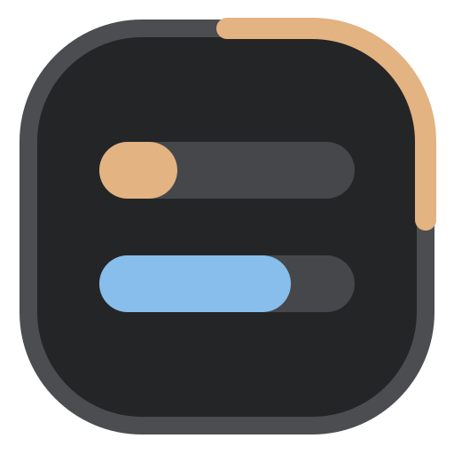

A **Codex / Work** limit panel for desktop ChatGPT on Windows. Shows remaining 5-hour and weekly quotas, reset times, available resets with expiration dates, and the Codex credit balance. Three panel sizes, light and dark themes, plus taskbar and tray indicators.

**[Download for Windows x64](https://github.com/MrBogomoll/chatgpt-limit-panel/releases/latest)** · [Update](UPGRADING.md) · [Uninstall](UNINSTALL.md) · [All releases](https://github.com/MrBogomoll/chatgpt-limit-panel/releases)

Download the built application ZIP under **Assets**. GitHub's **Source code** archives contain source files and are not plugin installation packages.

## Features

- **Codex / Work limits:** remaining 5-hour and weekly quotas with reset dates and times, refreshed about every 30 seconds. Instant shows the same counters.
- **Available resets:** a count and nearest expiration on the panel, plus a submenu listing every expiration date and time. The block turns orange at 10 days or less and red at 3 days or less. Viewing does not redeem a reset.
- **Codex credits:** a separate balance between resets and quotas. Reset and credit blocks can be toggled independently. The current data source does not provide the API billing balance.
- **Three sizes:** full, compact and ultracompact. Left-click cycles views; right-click opens settings. The panel automatically shrinks when space is limited.
- **Bars and outline:** choose the indicator combination and which quota drives the outline. Orange means ≤30% remaining; red means ≤10%. Ultracompact always keeps both bars, and stale data is dimmed.
- **Placement:** pin to the sidebar or drag freely inside ChatGPT. Positions persist and can be reset from the menu.
- **Taskbar and tray:** a draggable percentage indicator and a separately enabled live tray icon showing both quotas.
- **Appearance:** dark, light and automatic themes, Russian and English, and independent panel background opacity and taskbar indicator transparency. Preferences persist.

## Preview

Resets and credits can be toggled independently through **Right-click → Panel content**. Each example below is a separate image with demonstration data.

### Full view

| Indicator | Limits only | With resets | With credits | Both blocks |
| :--- | :---: | :---: | :---: | :---: |
| Bars and outline | 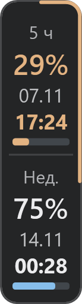 | 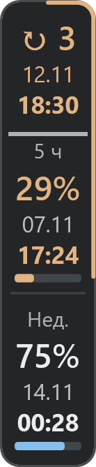 | 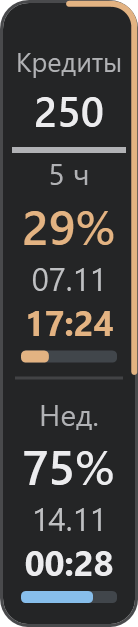 | 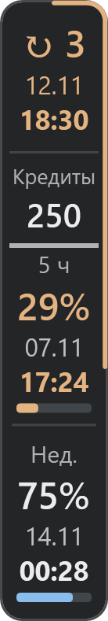 |
| Outline only | 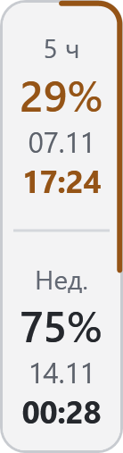 | 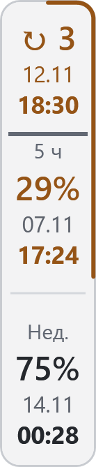 | 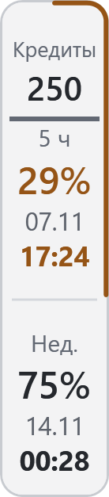 | 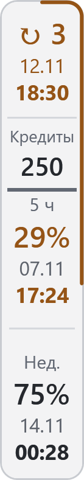 |

### Compact view

| Indicator | Limits only | With resets | With credits | Both blocks |
| :--- | :---: | :---: | :---: | :---: |
| Bars and outline | 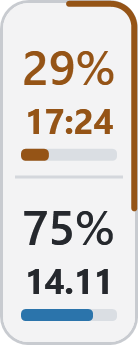 | 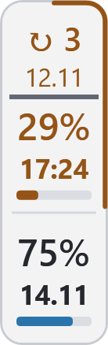 | 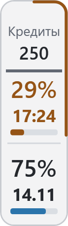 | 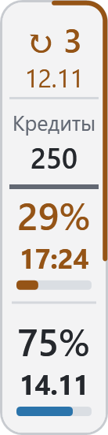 |
| Outline only | 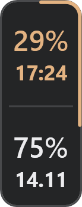 | 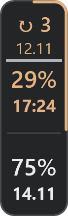 | 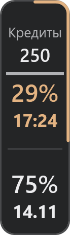 | 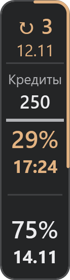 |

### Ultracompact view

Both quota bars are always visible; optional blocks show only the reset count and credit balance.

| Limits only | With resets | With credits | Both blocks |
| :---: | :---: | :---: | :---: |
| 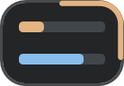 | 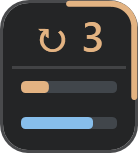 | 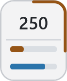 | 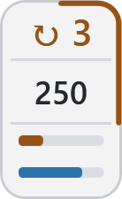 |

### Beside the chat

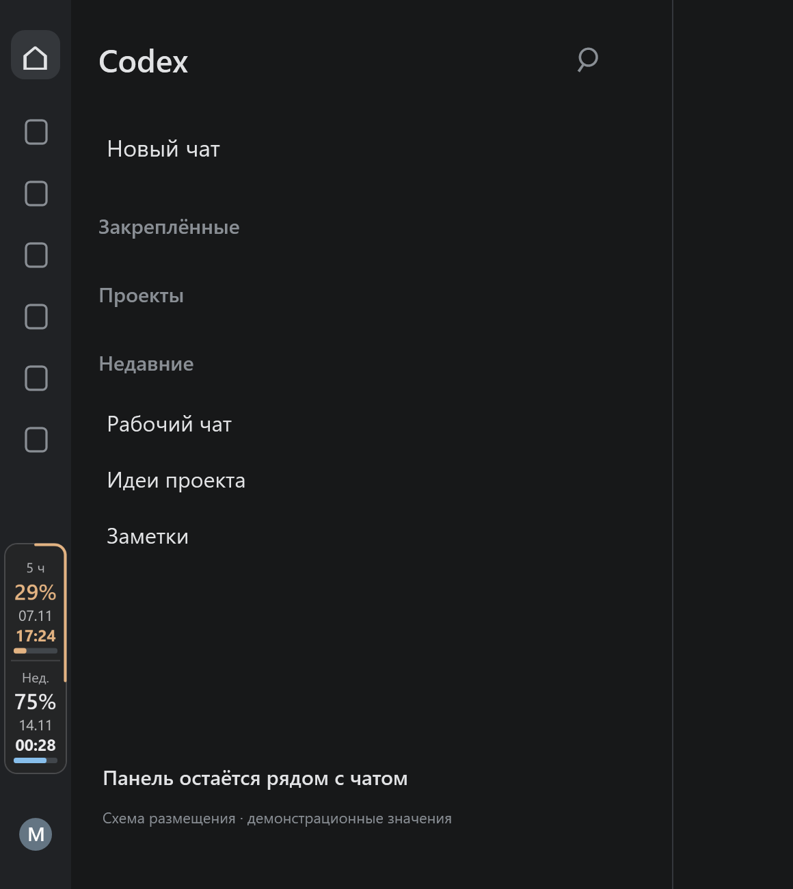 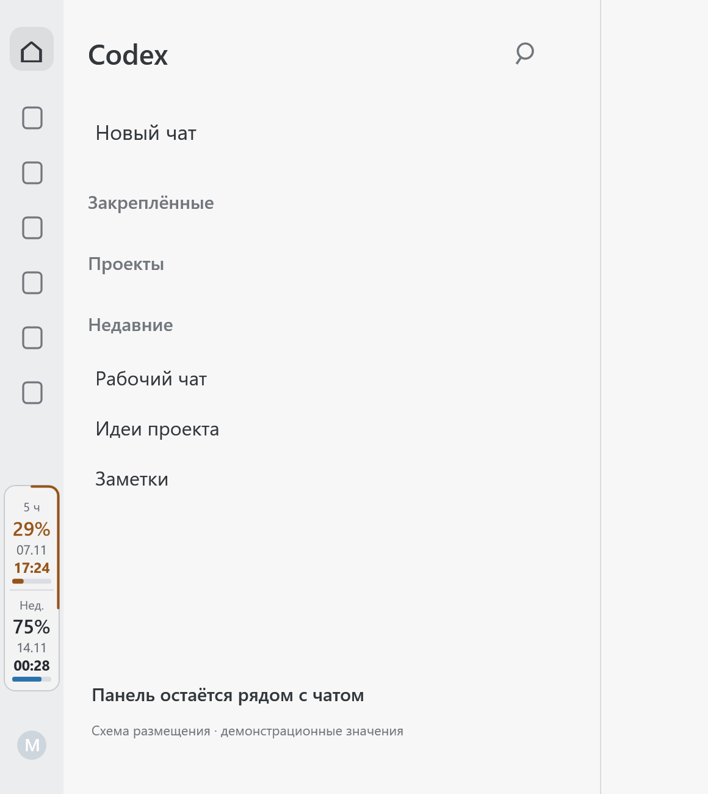

### On the Windows taskbar

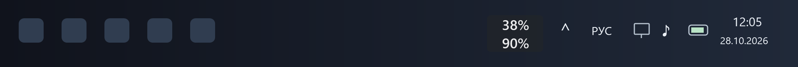

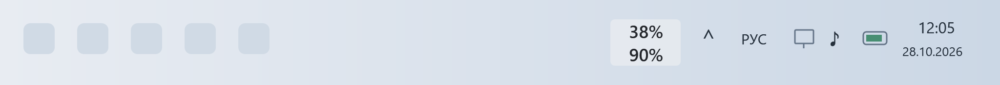

The panels are rendered from the actual application controls. Values are demonstration data; the surrounding chat and taskbar are schematic illustrations, not desktop screenshots.

## Installation

Requires Windows x64, a desktop ChatGPT client supporting local plugins, and installed Codex signed in to the intended account. A separate API key, Git and Node.js installation are not required.

1. Download the built ZIP using the link above.
2. Open **Plugins → Add → Upload plugin archive** and select the ZIP.
3. Open **ChatGPT Limit Panel** and its control card.
4. Click **Start**.

First activation creates a per-user Windows autostart task; it can be disabled in the panel menu. To enable the taskbar indicator, use **Right-click the panel → Placement → Taskbar → Show percentages**. Enable the live icon through **Right-click the tray icon → Placement → Live tray icon**.

With the taskbar indicator **or** live tray icon enabled, the monitor can refresh limits without an open ChatGPT window. Closing the control card does not stop the monitor; choose **Stop panel** to stop it.

## Updating and uninstalling

**Check for a new version** checks the stable release and offers to open its page. ZIP installation is manual. Guides: [update](UPGRADING.md) · [complete uninstall](UNINSTALL.md). See [CHANGELOG](CHANGELOG.md) and [releases](https://github.com/MrBogomoll/chatgpt-limit-panel/releases) for the history of changes.

## Compatibility and data

The panel has been checked on Windows 11, including Start11 and placement next to NetWorx. Windows 10 compatibility is not yet confirmed. If ZIP import is unavailable or an error occurs, include the Windows version, client version and details in [Issues](https://github.com/MrBogomoll/chatgpt-limit-panel/issues).

The program uses your existing local Codex sign-in. User credentials and settings are not included in the archive. This is an independent project, not an official OpenAI product. [ZIP checksum for 1.7.6](https://github.com/MrBogomoll/chatgpt-limit-panel/releases/download/v1.7.6/chatgpt-limit-panel-1.7.6-windows-x64.zip.sha256).

## Data and security

The panel requests the current account’s limits through the local Codex App Server. Preferences and state are stored locally in `%LOCALAPPDATA%\ChatGPTLimitPanel` (or the legacy `ChatGPTQuotaOverlay` folder). Checking for updates contacts the GitHub API. See the [security policy](SECURITY.md) for reporting vulnerabilities.

## License

The project source code is distributed under the [MIT License](LICENSE). Node.js included in the packaged build has its [own license](third-party/NODE-LICENSE.txt).

## Development

The repository contains source code, tests and build tools. See [building and testing](docs/BUILDING.md), [architecture](docs/ARCHITECTURE.md) and [contribution guide](CONTRIBUTING.md).
