# ChatGPT Limit Panel


[Русский](README.md)

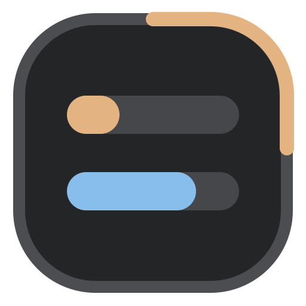

A **Codex / Work** limit panel for desktop ChatGPT on Windows. Shows remaining 5-hour and weekly quotas, reset times, available resets with expiration dates, and the Codex credit balance. Three panel sizes, light and dark themes, plus taskbar and tray indicators.

**[Download for Windows x64](https://github.com/MrBogomoll/chatgpt-limit-panel/releases/latest)** · [Update](UPGRADING.md) · [Uninstall](UNINSTALL.md) · [All releases](https://github.com/MrBogomoll/chatgpt-limit-panel/releases)

Download the built application ZIP under **Assets**. GitHub's **Source code** archives contain source files and are not plugin installation packages.

Already installed? **Right-click the panel → Check for a new version → Update**. If there is no **Update** button, see the [manual upgrade guide](UPGRADING.md#english).

## Features

- **Codex / Work limits:** remaining 5-hour and weekly quotas with reset dates and times, refreshed about every 30 seconds. Instant shows the same counters. If the 5-hour limit is absent, as it can be on Pro, the panel hides it and uses the weekly limit for the outline. **Panel content → Quota blocks** can keep both blocks (with ∞) or show only the weekly quota.
- **Available resets:** a count and nearest expiration on the panel, plus a submenu listing every expiration date and time. The block turns orange at 10 days or less and red at 3 days or less. Viewing does not redeem a reset.
- **Codex credits:** a separate balance between resets and quotas. Reset and credit blocks can be toggled independently. The current data source does not provide the API billing balance.
- **Three sizes:** full, compact and ultracompact. Left-click cycles views; right-click opens settings. The panel automatically shrinks when space is limited.
- **Bars and outline:** choose the indicator combination and which quota drives the outline. Orange means ≤30% remaining; red means ≤10%. Ultracompact keeps a bar for each shown quota and dims stale data.
- **Placement:** pin to the sidebar or drag freely inside ChatGPT. Positions persist and can be reset from the menu.
- **Taskbar and tray:** a draggable indicator can show quota percentages or Codex credits. The live tray icon is enabled separately.
- **Appearance:** dark, light and automatic themes, Russian and English, and independent panel background opacity and taskbar indicator transparency. Preferences persist.

## Preview

Resets and credits can be toggled independently through **Right-click → Panel content**. Each example below is a separate image with demonstration data.

### Full view

| Indicator | Limits only | With resets | With credits | Both blocks |
| :--- | :---: | :---: | :---: | :---: |
| Bars and outline | 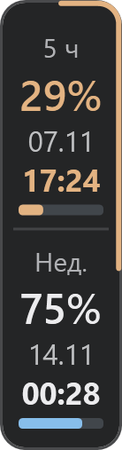 | 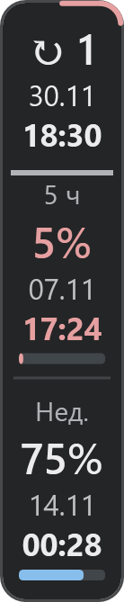 | 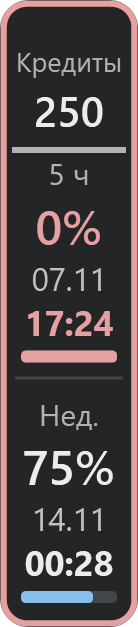 | 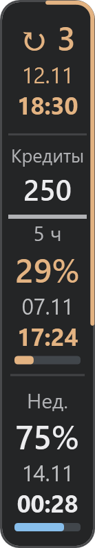 |
| Outline only | 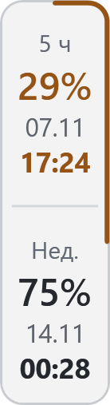 | 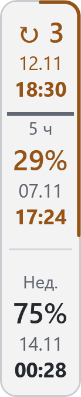 | 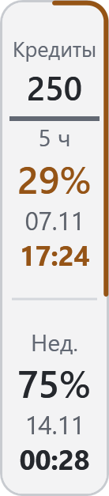 | 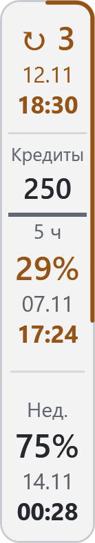 |

### Compact view

| Indicator | Limits only | With resets | With credits | Both blocks |
| :--- | :---: | :---: | :---: | :---: |
| Bars and outline | 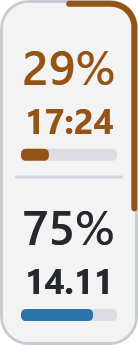 | 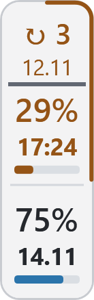 | 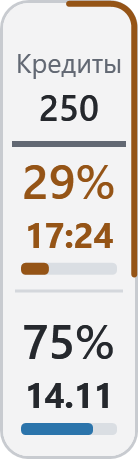 | 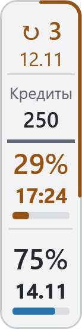 |
| Outline only | 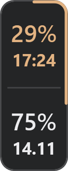 | 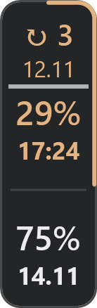 | 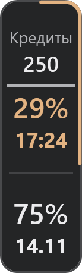 | 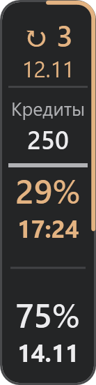 |

### Ultracompact view

Both quota bars are always visible; optional blocks show only the reset count and credit balance.

| Limits only | With resets | With credits | Both blocks |
| :---: | :---: | :---: | :---: |
| 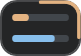 | 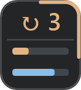 | 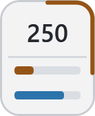 | 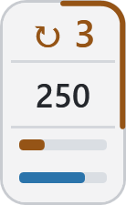 |

### Beside the chat

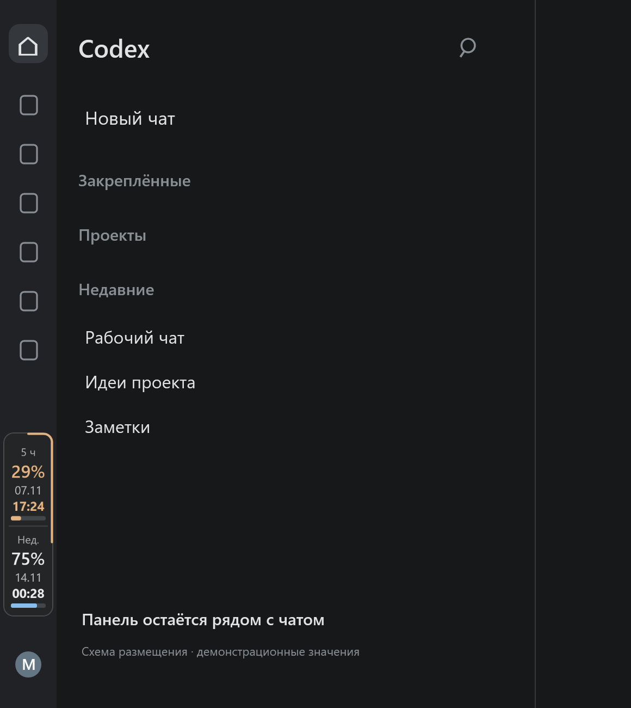 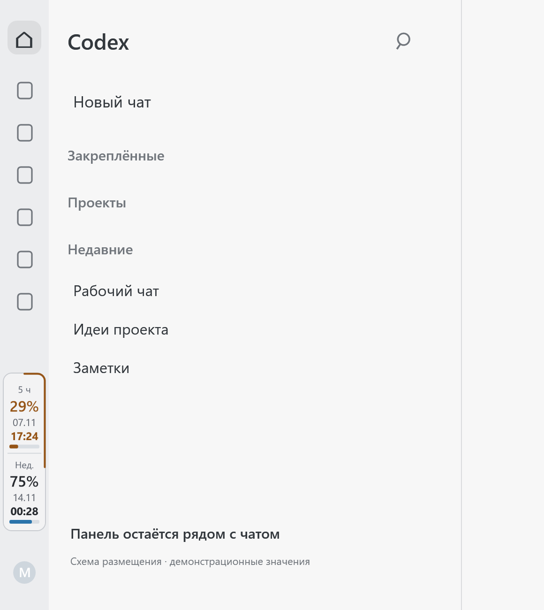

### On the Windows taskbar

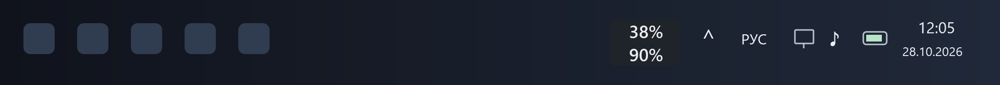

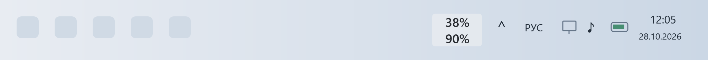

The panels are rendered from the actual application controls. Values are demonstration data; the surrounding chat and taskbar are schematic illustrations, not desktop screenshots.

## Installation

Requires Windows x64, a desktop ChatGPT client supporting local plugins, and installed Codex signed in to the intended account. A separate API key, Git and Node.js installation are not required.

Download the built ZIP under **Assets** and choose one method:

- **In ChatGPT:** open **Plugins → Add → Upload plugin archive** and select the ZIP.
- **With the local installer for one-click updates:** extract the ZIP, open PowerShell in the extracted folder, and run the command below. `codex --version` must work in the same PowerShell session.

  ```powershell
  .\runtime\node.exe .\overlay\install-plugin.mjs .
  ```

Then open the [control card](#how-to-open-the-control-card) and click **Start**.

First activation creates a Windows launch task for your account; autostart can be turned off in the panel settings. Enable the taskbar indicator under **Placement → Taskbar → Show indicator** and use **Content** to choose percentages or credits. Turn on the live tray icon under **Placement → Live tray icon**.

With the taskbar indicator **or** live tray icon enabled, the monitor can refresh limits without an open ChatGPT window. Closing the control card does not stop the monitor; choose **Stop panel** to stop it.

## How to open the control card

The card is the plugin's reply in chat with **Start**, **Stop** and **Refresh status** buttons.

1. Start a new chat in the desktop app where the plugin is installed.
2. Type **@** in the message box, search for **ChatGPT Limit Panel**, and select it under **Plugins**.
3. Send: **"Open the Codex/Work limit panel controls."** The reply will contain the control card.

If the plugin is missing, check that it is installed and enabled under **Plugins**. Start a new chat after updating so it receives the new tools. See [OpenAI's documentation](https://learn.chatgpt.com/docs/build-plugins) for selecting plugins with @.

## Updating and uninstalling

The teal dot marks a new stable release. Hide it under **Settings → Show update dot**. You can still check for and install updates.

**Update:** open the panel's own menu and select **Check for a new version → Update**. The panel verifies the archive and restarts itself; ChatGPT can stay open. If only **Open release** appears, see the [ZIP upgrade instructions](UPGRADING.md#english).

**Uninstall:** open the [control card](#how-to-open-the-control-card) → **Plugin settings → Remove plugin…**. The confirmation window lets you choose whether to keep your settings and logs. See the [uninstall guide](UNINSTALL.md) and [changelog](CHANGELOG.md).

## Compatibility and data

The panel has been tested on Windows 11, including setups with Start11. Windows 10 compatibility is not yet confirmed. If ZIP import is unavailable or an error occurs, include the Windows version, client version and details in [Issues](https://github.com/MrBogomoll/chatgpt-limit-panel/issues).

The panel reads the current account’s limits through the local Codex App Server. Settings and the failure log are stored in `%LOCALAPPDATA%\ChatGPTLimitPanel` (or the legacy `ChatGPTQuotaOverlay` folder). The log records the stage and duration of recent failures without tokens or server responses. The panel contacts GitHub for releases and archives; each release includes a SHA-256 checksum next to the ZIP under **Assets**. This is an independent project, not an official OpenAI product. See the [security policy](SECURITY.md) to report a vulnerability.

## License

The project source code is distributed under the [MIT License](LICENSE). Node.js included in the packaged build has its [own license](third-party/NODE-LICENSE.txt).

## Development

The repository contains source code, tests and build tools. See [building and testing](docs/BUILDING.md), [architecture](docs/ARCHITECTURE.md) and [contribution guide](CONTRIBUTING.md).
