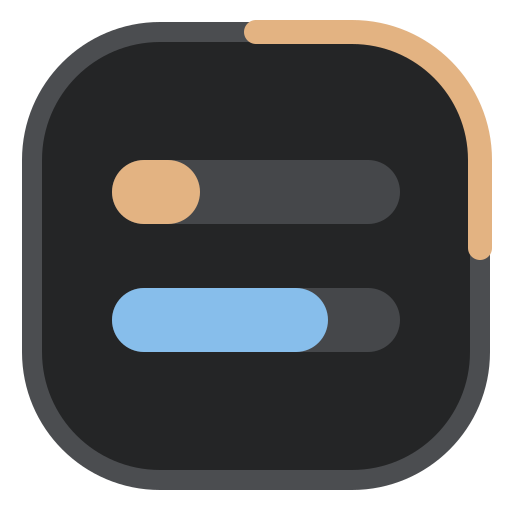
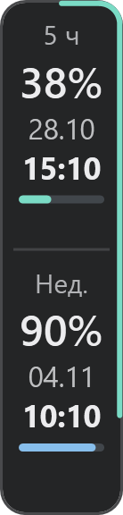
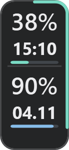
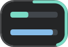
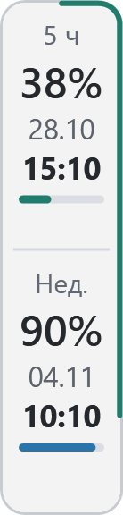
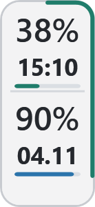
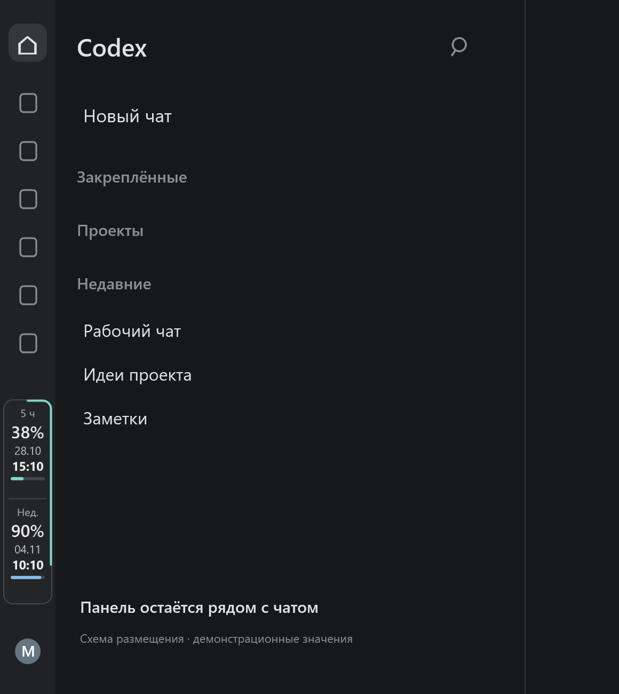
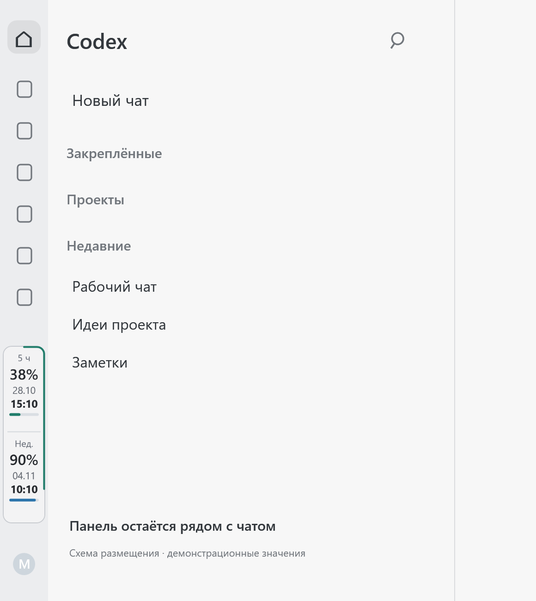
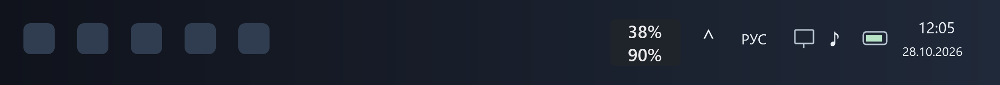
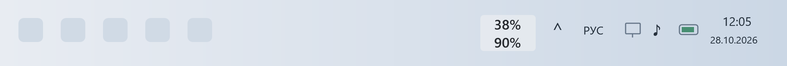

# ChatGPT Limit Panel

[English](README.en.md)



Панель оставшихся лимитов Codex / Work для настольного ChatGPT в Windows. Показывает проценты и время сброса в боковой полосе приложения, а по желанию — два процента на панели задач Windows. В Instant отображается тот же общий счётчик Codex / Work.

**[Скачать ChatGPT Limit Panel 1.6.1 для Windows x64](https://github.com/MrBogomoll/chatgpt-limit-panel/releases/download/v1.6.1/chatgpt-limit-panel-1.6.1-windows-x64.zip)** · [Все релизы](https://github.com/MrBogomoll/chatgpt-limit-panel/releases) · [Обновление установленной панели](UPGRADING.md)

Выбирай готовый ZIP **chatgpt-limit-panel-1.6.1-windows-x64.zip** в Assets. В него входят программы панели, Node.js и лицензия. Git и отдельная установка Node.js не требуются. Автоматические архивы GitHub **Source code** содержат материалы репозитория.

## Исправлено в 1.6.1

- Обновление без обязательного посещения Планировщика: останови панель, замени ZIP и нажми «Запустить».
- Новая версия сама переносит свою проверенную задачу запуска на новый путь, сохраняя настройки и выбор автозапуска.
- [Инструкция по обновлению](UPGRADING.md) упрощена на русском и английском.

## Свободное расположение и непрозрачность

- **Свободное расположение панели** внутри окна ChatGPT: сними галочку «Закрепить на боковой панели» и перетащи панель ЛКМ. Галочка доступна в меню самой панели и значка в трее.
- При откреплении панель остаётся у боковой полосы. Свободное положение сохраняется после перезапуска, а границы окна учитываются при изменении размера.
- **Отдельная непрозрачность фона панели**: ПКМ → «Непрозрачность фона». 100% убирает просвечивание переписки; прозрачность индикатора панели задач остаётся независимой.
- «Расположение по умолчанию» возвращает свободную панель к боковой полосе без включения закрепления.

Совместимость с Windows 10 пока исследуется.

## Исправлено в 1.3.2

- Проверка обновлений переведена в основной публичный репозиторий с исходниками и релизами.
- Для версий 1.3.1 и старше нужен однократный ручной переход: [инструкция](UPGRADING.md).

## Возможности, добавленные в 1.3.0

- Отдельно включаемый индикатор панели задач: 5-часовой остаток сверху, недельный снизу; выбор размещения слева или справа.
- Стабильное прикрепление к панели задач при переключении между ChatGPT и играми, открытии «Пуска» и меню Start11.
- Обновление лимитов с закрытым окном ChatGPT, пока включён индикатор панели задач.
- Ползунок прозрачности фона 0–100% через ПКМ по индикатору. Проценты остаются читаемыми, а меню доступно и при прозрачном фоне.
- Единые названия программы, значков и файлов сборки; ручная проверка новых версий через GitHub.

## Как выглядит

| Тема | Полный | Компактный | Ультракомпактный |
| :--- | :---: | :---: | :---: |
| Тёмная |  |  |  |
| Светлая |  |  |  |

### Рядом с чатом

 

### На панели задач Windows





Сами панели отрисованы из компонентов программы. Значения демонстрационные; окружение чата и панели задач показано схематично. Это иллюстрации размещения, а не снимки рабочего стола.

## Возможности

- Серверные проценты остатка и даты сброса, обновление примерно каждые 30 секунд. Устаревшие и неизвестные данные отличаются от актуальных.
- Три вида боковой панели. ЛКМ переключает полный, компактный и ультракомпактный; ПКМ открывает настройки.
- Полоски, контур, оба индикатора или отключение графики. В ультракомпактном виде две полоски остаются всегда.
- Общий выбор 5-часового или недельного лимита для контура всех видов.
- Приглушённый оранжевый при остатке ≤30%, красный при ≤10%. Известный ноль заполняет включённые индикаторы красным.
- Тёмная, светлая и автоматическая темы; русский и английский интерфейсы.
- Сохранение языка, темы, вида, прозрачности, индикаторов и настройки автозапуска.
- Размещение индикатора в проверенном свободном промежутке панели задач с учётом кнопок приложений, трея, часов и соседних виджетов.

## Установка

Требуются Windows x64, поддерживающий локальные плагины настольный клиент ChatGPT и установленный Codex с выполненным входом в нужный аккаунт. API-ключ не нужен.

1. Скачай готовый ZIP по ссылке выше.
2. Открой **Плагины → Добавить → Загрузить архив плагина** и выбери ZIP.
3. Открой **ChatGPT Limit Panel** и его карточку управления.
4. Нажми **«Запустить»** один раз.

Первый запуск настраивает пользовательский автозапуск Windows без администратора и пароля. Боковая панель появляется примерно через 3 секунды после обнаружения окна ChatGPT. Индикатор панели задач включается отдельно через ПКМ по панели → **«Панель задач» → «Показывать проценты»**.

При включённом индикаторе панели задач лимиты обновляются и с закрытым окном ChatGPT. Если он выключен, монитор ждёт открытия окна. Закрытие карточки управления не останавливает панель. Явная команда «Остановить панель» завершает текущий монитор.

## Управление и обновления

ПКМ по боковой панели открывает вид, индикаторы, источник контура, тему, язык, автозапуск, обновление лимитов и остановку. ПКМ по индикатору панели задач открывает его размещение и прозрачность.

**«Проверить новую версию»** вручную проверяет последний стабильный выпуск. Если доступна новая версия, **«Открыть релиз»** ведёт на страницу скачивания. Установка обновления выполняется вручную. Ошибки сети и ограничения GitHub показываются отдельно.

## Совместимость

Фактически проверено на Windows 11, включая Start11 и соседний индикатор NetWorx. Проверка на физической Windows 10 пока не выполнена. Если в клиенте нет загрузки ZIP или возникла ошибка, укажи версию Windows, клиента и описание ситуации в [Issues](https://github.com/MrBogomoll/chatgpt-limit-panel/issues).

## Контрольная сумма и данные

[SHA-256](https://github.com/MrBogomoll/chatgpt-limit-panel/releases/download/v1.6.1/chatgpt-limit-panel-1.6.1-windows-x64.zip.sha256):

```text
e19ba7aaf7ae902c27e4ae28edb00a129f9674fef6bfd78c19c97e5ea1b6b4a2
```

Используется собственная локальная авторизация Codex. Данные входа автора, его переписка и настройки аккаунта в архив не входят. Клиент ChatGPT не изменяется. ChatGPT Limit Panel — независимый проект, не официальный продукт OpenAI.

## Исходники и разработка

Здесь находятся исходники программы, тесты, инструменты сборки и примеры интерфейса. Инструкции: [сборка и проверки](docs/BUILDING.md), [архитектура](docs/ARCHITECTURE.md), [участие в разработке](CONTRIBUTING.md). Основная ветка — `main`, экспериментальные ветки имеют префикс `beta/`.

### Живая иконка в трее / Live tray icon

ПКМ по значку в трее → **«Живая иконка в трее»**. Верхняя полоска показывает 5-часовой остаток, нижняя — недельный. Контур использует общий выбор лимита и режима индикатора. Без галочки отображается исходный логотип. Настройка сохраняется; живые данные обновляются и без открытого окна ChatGPT, пока работает монитор.

Right-click the tray icon → **Live tray icon**. The upper bar shows the 5-hour remaining limit, the lower bar shows the weekly limit. The outline follows the shared indicator mode and selected limit. Unchecked restores the original logo. The choice persists; live quota refreshes without an open ChatGPT window while the monitor is running.
